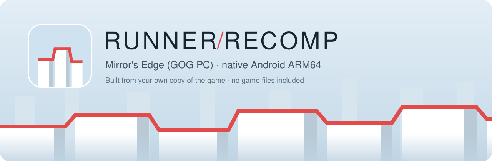

  

  <a href="https://github.com/singlemate/RunnerRecompiled/releases/latest/download/RunnerBuilder.exe"><b>Download RunnerBuilder</b></a> ·
  <a href="https://github.com/singlemate/RunnerRecompiled/releases/latest">Release notes</a> ·
  <a href="https://github.com/singlemate/RunnerRecompiled/issues/new?template=bug_report.yml">Report a bug</a>

# RunnerRecompiled

An unofficial, fan-made static recompilation of the **Windows PC (GOG)** version of
*Mirror's Edge* (2009) to native **Android ARM64**. No emulator runs at play time: the
game's x86 code is translated to C ahead of time, on your own PC, from your own copy.
Windows, Direct3D 9 and the other system services the game expects are provided by a
runtime in this repository, and the graphics go to Vulkan through DXVK.

**No game files or game code are included or linked.** You need your own copy of the game
from GOG; other releases do not work.

> **Status: in testing, version 0.3.2.** The game installs, starts, goes through the menus
> and has been played through several chapters on a real tablet. Expect bugs, and please
> [report them](https://github.com/singlemate/RunnerRecompiled/issues/new?template=bug_report.yml).

## Getting it running

You need a Windows x64 PC, an installed GOG copy of the game, about 16 GB of free disk space
and about 150 MB of downloads.

1. Download [RunnerBuilder.exe](https://github.com/singlemate/RunnerRecompiled/releases/latest/download/RunnerBuilder.exe).
   It is not signed, so Windows may warn you the first time.
2. Choose the folder of the installed game, accept the Android SDK terms and press Build.
   This takes from 5 to 30 minutes, depending on the CPU.
3. Press **Install on the device…** to install the APK and copy the game over USB or Wi-Fi
   debugging (new in 0.3.1, the full copy is not tested yet). Or copy the resulting folder
   to the device, install the APK and choose `MirrorsEdge-GOG.zip` in the app. The game
   needs about 12 GB on the device.

**The result contains code and files from your copy of the game. Keep it to yourself: do not
publish or share it.**

RunnerBuilder is described in [pc/BUILDER.md](pc/BUILDER.md). To do the same by hand, see
[pc/SELFBUILD.md](pc/SELFBUILD.md). Versions for Linux and macOS are planned.

## Devices

You need Android 10 or newer, Vulkan and an ARMv8.4 CPU.

| Device | Chip | Result |
|---|---|---|
| Lenovo Legion Y700 Gen 4 | Snapdragon 8 Elite, Adreno 830 | Main test device, works with the system driver |
| Samsung Galaxy Z Fold6 | Snapdragon 8 Gen 3, Adreno 750 | Works with a Mesa Turnip driver chosen in the app's settings |

## What works

- The game itself, its PhysX 2.8 physics, audio and Bink videos, all from recompiled code.
- Touch controls and Android gamepads. A DualSense was tested, with rumble and PlayStation
  button icons in the game. Nintendo-style layouts are available.
- Fills the whole screen on displays wider than 16:9, without black bars.
- Field-of-view setting, frame cap, FSR 1 and SGSR 1 upscalers, graphics options in the app and an economy mode.
- Your own GPU driver: load an AdrenoTools package in the settings.
- Pipeline cache kept between sessions, to reduce stutter when shaders are first used.
- A sensible graphics preset on first launch, and a notice when a new version is out.
- App and RunnerBuilder in English, Russian, German, French, Spanish, Portuguese, Polish and
  Chinese. Translations other than Russian are machine-made: corrections are welcome.

## Known gaps

- About 45 to 60 fps in play on the Y700, and not a steady 60.
- The device gets hot in long sessions (44.5 °C battery temperature at the end of a chapter).
- The red menu panels keep their 16:9 layout on wider screens.
- Loading-screen text can be cut off on very wide screens.
- Option labels in the video settings overlap at low resolutions.
- The game's settings reset when its files are replaced.
- Not checked yet: Switch Pro controllers, the sniper scope with a gamepad, in-engine
  cutscenes on wide screens, the quality and heat impact of the upscalers.

To report a problem, use **Settings → Support → Send logs** right after it happens.

## How it works

| Path | Contents |
|---|---|
| `pc/tools/` | The lifter from x86 to C, the build scripts and RunnerBuilder |
| `pc/runtime/` | Runtime: Win32 services, D3D9 bridge, input, audio and Unreal Engine 3 fixes |
| `pc/dxvk/` | Patches for DXVK Native on Android, and their licences |
| `pc/harness/` | Small test programs |
| `android/` | The Android app: launcher, first-run setup, game screen, controls |

The design of the lifter is in [pc/LIFTER-DESIGN.md](pc/LIFTER-DESIGN.md). Generated code,
game data and build outputs stay in a private `work/` folder and are never committed.

## Credits and licenses

- [DXVK](https://github.com/doitsujin/dxvk): zlib license. The upscaler code added by the patch
  is listed in [pc/dxvk/THIRD-PARTY.md](pc/dxvk/THIRD-PARTY.md).
- [libadrenotools](https://github.com/bylaws/libadrenotools): BSD 2-Clause.
- The high-resolution font fix and the removal of black bars follow the analysis in
  [Mirror's Edge Tweaks](https://github.com/softsoundd/MirrorsEdgeTweaks) by softsoundd, and are
  reimplemented in `pc/runtime/rt_ue3.c`.
- Patches in this repository keep the license of the project they modify.
- Original code here: MIT, see [LICENSE](LICENSE).

*Mirror's Edge* is a trademark of Electronic Arts. RunnerRecompiled is an independent fan
project; it is not affiliated with, endorsed by or sponsored by EA or DICE. The game title is
used only to say which game this project works with.
